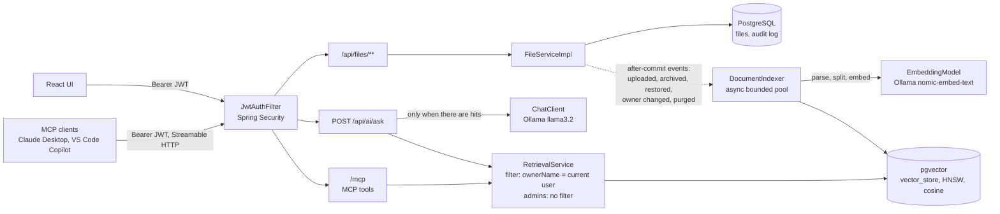

# SecureDocs AI

**Ask questions about your own documents and get cited answers, from a web UI or any MCP client, without ever seeing anyone else's data.**

SecureDocs AI is a Spring Boot file storage service with permission-aware retrieval-augmented generation (RAG). Uploaded documents are chunked, embedded and stored in pgvector. Users ask questions through a REST endpoint, the React UI, or MCP clients such as Claude Desktop and VS Code Copilot. Every retrieval is filtered by the authenticated user inside the vector query itself.


## Architecture



## Features

**Document Q&A (new)**
- **Cited answers:** `POST /api/ai/ask` retrieves the most relevant chunks from the caller's documents and answers with `[1]`, `[2]` citations, returning file name, page (PDFs) and a snippet for each source.
- **Permission-aware retrieval:** non-admins are restricted by an `ownerName == currentUser` filter built with Spring AI's `FilterExpressionBuilder` and applied inside the pgvector query, so top-K is computed over the caller's chunks only. Admins search everything. Identity comes only from the JWT, never from the request body, a tool argument or the model.
- **MCP server:** `/mcp` (Streamable HTTP) exposes `search_my_documents`, `list_my_documents` and `get_document_text` to any MCP client, protected by the same JWT filter as the REST API. Missing and not-owned documents return the same "not found".
- **Index mirrors the file lifecycle:** upload indexes, archive and purge delete chunks, restore and owner change re-index. Indexing runs after the database commit on a bounded thread pool, and each file shows its `index_status` (PENDING, INDEXED, FAILED, UNSUPPORTED).
- **Formats:** PDF (page-aware, so citations include page numbers), DOCX, TXT and Markdown, split into ~500-token chunks.
- **Prompt-injection hygiene:** retrieved text is placed in delimited source blocks that documents cannot forge, the system prompt treats it as data, tools are read-only, and authorization never depends on the model.
- **No hits, no model call:** if nothing relevant is found the answer is "I couldn't find this in your documents." and the model is never called. Model failures and timeouts return an RFC 7807 `503`.
- **React Ask panel** with citations, plus an index-status badge on every file.

**File storage (existing)**
- **File lifecycle:** binary upload/download, soft-delete ("archive"), restore, metadata update, paginated listing.
- **Audit log:** every lifecycle event is recorded in `file_audit_log`, which has no foreign key to `files`, so history survives the nightly purge.
- **Scheduled purge:** files archived for more than 30 days are permanently deleted at 2 AM (row, binary and vector chunks).
- **JWT + Google OAuth2 login**, with `USER`/`ADMIN` RBAC. Regular users only see their own files; the owner is always taken from the authenticated principal.

## Tech stack

Java 17, Spring Boot 3.5, Spring AI 1.1 (pgvector, Ollama, PDF/Tika readers, MCP server), PostgreSQL 16 + pgvector, Ollama (`nomic-embed-text`, `llama3.2:3b`), React, JUnit 5, Mockito, Testcontainers, Docker, Kubernetes, GitHub Actions.

## Quickstart

Requires Java 17, Maven, Docker, Node 20 and [Ollama](https://ollama.com).

```bash
# 1. Postgres with pgvector
docker compose up -d
# If another Postgres already uses port 5432:
#   POSTGRES_PORT=5433 docker compose up -d   and   export DB_URL=jdbc:postgresql://localhost:5433/filestorage

# 2. Models
ollama pull nomic-embed-text
ollama pull llama3.2:3b          # 8 GB RAM or less: llama3.2:1b, then export AI_CHAT_MODEL=llama3.2:1b

# 3. Backend (http://localhost:8080)
cd file-storage-service/backend
mvn spring-boot:run

# 4. Demo users and documents (alice: fictional runbooks, bob: fictional policies)
bash scripts/seed.sh

# 5. Frontend (http://localhost:3000)
cd file-storage-service/frontend
npm install && npm start
```

Try it from the command line:

```bash
TOKEN=$(curl -s -X POST localhost:8080/api/auth/login -H 'Content-Type: application/json' \
  -d '{"username":"alice","password":"Passw0rd!"}' | jq -r .token)

curl -s -X POST localhost:8080/api/ai/ask -H "Authorization: Bearer $TOKEN" -H 'Content-Type: application/json' \
  -d '{"question":"Services throw OutOfMemoryError after a deploy. What should I check?"}' | jq

# Bob's document: alice gets "I couldn't find this in your documents."
curl -s -X POST localhost:8080/api/ai/ask -H "Authorization: Bearer $TOKEN" -H 'Content-Type: application/json' \
  -d '{"question":"What is the travel reimbursement limit?"}' | jq
```

### Configuration

All settings have local defaults in `application.properties`.

| Variable | Purpose | Default |
|---|---|---|
| `DB_URL`, `DB_USERNAME`, `DB_PASSWORD` | PostgreSQL connection | `jdbc:postgresql://localhost:5432/filestorage`, `postgres`, `password` |
| `OLLAMA_BASE_URL` | Ollama server | `http://localhost:11434` |
| `AI_CHAT_MODEL` | Chat model for `/api/ai/ask` | `llama3.2:3b` |
| `JWT_SECRET` | HMAC signing key for JWTs | dev-only placeholder, **override before any real deployment** |
| `STORAGE_LOCATION` | Where uploaded binaries are stored | `./uploads` |
| `ADMIN_USERNAME` / `ADMIN_PASSWORD` / `ADMIN_EMAIL` | Admin account seeded on first boot | `admin` / `admin123` / `admin@filestorage.local` |
| `CORS_ALLOWED_ORIGIN`, `FRONTEND_URL` | Frontend origin for CORS and the OAuth2 redirect | `http://localhost:3000` |

Retrieval settings live under `ai.*` (`default-top-k`, `max-top-k`, `similarity-threshold`, `max-question-length`).

**Google OAuth2 login** (optional): set `GOOGLE_CLIENT_ID` and `GOOGLE_CLIENT_SECRET` and run with `SPRING_PROFILES_ACTIVE=oauth2`.

## Using it from MCP clients

The MCP endpoint is `http://localhost:8080/mcp` (Streamable HTTP). It needs the same Bearer token as the REST API; without one the connection is rejected with `401`. Get a token with the login `curl` above.

**Claude Desktop** (Settings > Developer > Edit Config, then restart Claude Desktop fully):

```json
{
  "mcpServers": {
    "securedocs-ai": {
      "command": "npx",
      "args": ["-y", "mcp-remote", "http://localhost:8080/mcp", "--header", "Authorization:${AUTH_HEADER}"],
      "env": { "AUTH_HEADER": "Bearer <your token>" }
    }
  }
}
```

**VS Code Copilot** (`.vscode/mcp.json`; start the server from the MCP view, then use Copilot Chat in Agent mode):

```json
{
  "inputs": [{ "id": "token", "type": "promptString", "description": "SecureDocs JWT", "password": true }],
  "servers": {
    "securedocs-ai": {
      "type": "http",
      "url": "http://localhost:8080/mcp",
      "headers": { "Authorization": "Bearer ${input:token}" }
    }
  }
}
```

**MCP Inspector:** `npx @modelcontextprotocol/inspector`, transport Streamable HTTP, URL `http://localhost:8080/mcp`, header `Authorization: Bearer <token>`.

| Tool | What it returns |
|---|---|
| `search_my_documents(query, topK?)` | Cited excerpts: fileName, page, chunkIndex, score, text |
| `list_my_documents()` | The caller's active files with their index status |
| `get_document_text(fileId)` | The full text of one indexed file in chunk order, or "Document not found." |

## Tests

```bash
cd file-storage-service/backend
mvn test      # unit tests (Mockito), no Docker needed
mvn verify    # plus integration tests: needs Docker, never Ollama
```

The integration tests run against a real `pgvector/pgvector:pg16` container (Testcontainers) with a deterministic fake embedding model and a mocked chat model:
- `RetrievalSecurityIT`: users never retrieve each other's chunks, admins see all, archive removes chunks and restore brings them back, owner change moves chunks, and usernames with quotes cannot break or widen the filter.
- `AskEndpointIT`: through the real JWT filter, alice gets "couldn't find" for bob's document without a model call, gets a cited answer from her own, and owner fields smuggled into the body are ignored.
- `McpSecurityIT`: calls the MCP tools over HTTP with the MCP Java SDK client and checks owner scoping, identical "not found" for other users' and missing ids, and that a connection without a token is rejected.

## Design decisions

Why pgvector, why filter inside the vector query, why after-commit events, why MCP over HTTP, and the known weaknesses of each choice: see [docs/DECISIONS.md](docs/DECISIONS.md).

## Project layout

```
file-storage-service/
  backend/    Spring Boot API: file domain + com.filestorage.ai (indexing, retrieval, ask, mcp)
  frontend/   React SPA (files, Ask panel)
  k8s/        Deployment, Service, ConfigMap, Secret template, pgvector Postgres
sample-docs/  Fictional demo documents for alice and bob
scripts/      seed.sh: registers demo users and uploads their documents
docs/         DECISIONS.md, demo.gif
.github/workflows/ci.yml   Backend unit + integration tests, frontend build, Docker image build
```

## Docker and Kubernetes

```bash
docker build -t file-storage-backend:latest file-storage-service/backend
docker run -p 8080:8080 --env-file .env file-storage-backend:latest
```

See [file-storage-service/k8s/README.md](file-storage-service/k8s/README.md) for the apply order. The ConfigMap includes `OLLAMA_BASE_URL` and `AI_CHAT_MODEL`; the bundled Postgres uses the pgvector image.

## CI

`.github/workflows/ci.yml` runs on every push and pull request: `mvn verify` (unit tests plus Testcontainers integration tests on the runner's Docker), the frontend production build, and a Docker image build of the backend.

## Roadmap

- **Phase 2:** an agent with tool calling over these tools; sharing documents between users (retrieval filter extends from owner to owner-or-shared).
- **Phase 3:** AWS deployment (ECS Fargate, RDS for PostgreSQL with pgvector, S3 for binaries, SQS instead of in-process events, Bedrock models, CloudWatch), and a Python evaluation harness to measure retrieval quality and tune chunking.
